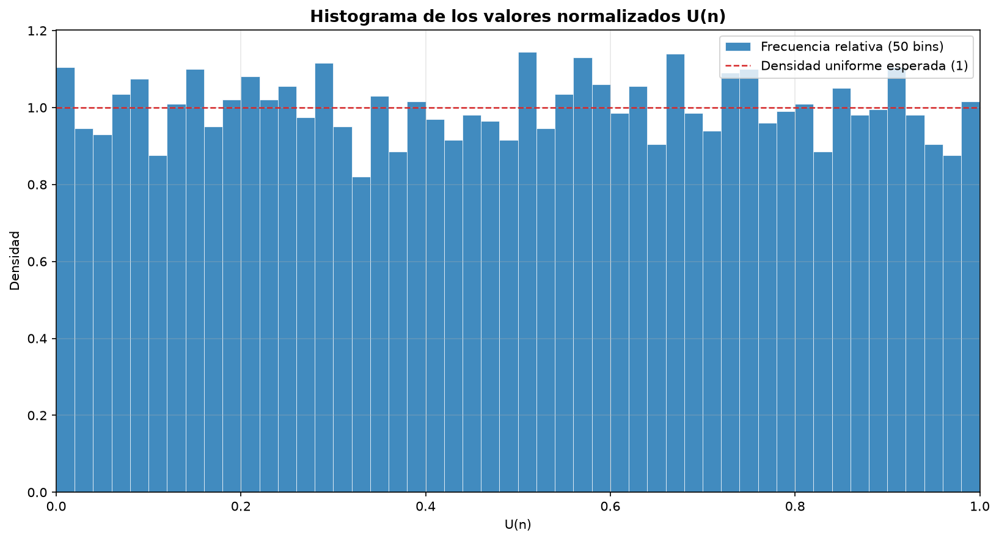
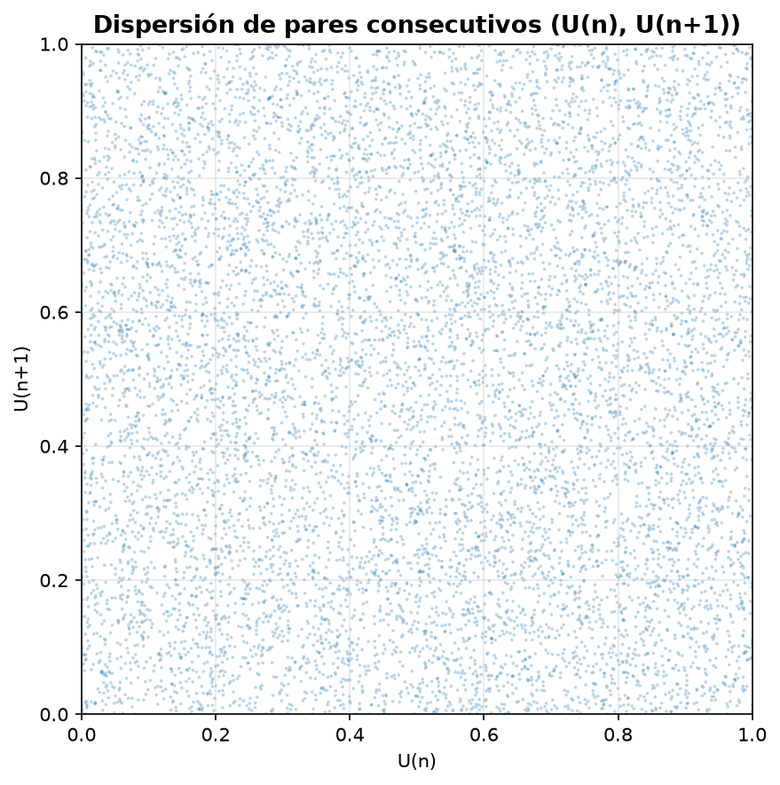

<a id="inicio"></a>

# Práctica 05 — Generador Congruencial Lineal (LCG) en Python y Java


Proyecto académico de la asignatura **Simulación** que implementa desde cero un
**Generador Congruencial Lineal (LCG)** en Python y Java, compara ambas
secuencias y analiza sus propiedades mediante archivos CSV, estadísticas
descriptivas y gráficas generadas con Matplotlib.

---

## Tabla de contenidos

1. [Descripción del proyecto](#descripcion-del-proyecto)
2. [Tecnologías utilizadas](#tecnologias-utilizadas)
3. [Instalación](#instalacion)
4. [Configuración del proyecto](#configuracion-del-proyecto)
5. [Uso del proyecto](#uso-del-proyecto)
6. [Estructura del proyecto](#estructura-del-proyecto)
7. [Información adicional](#informacion-adicional)
   - [Funcionalidades implementadas](#funcionalidades-implementadas)
   - [Resultados y validaciones](#resultados-y-validaciones)
   - [Análisis del período](#analisis-del-periodo)
   - [Cambio de semilla](#cambio-de-semilla)
   - [Gráficas generadas](#graficas-generadas)
   - [Pruebas y validaciones](#pruebas-y-validaciones)
   - [Mantenimiento y contribución](#mantenimiento-y-contribucion)
   - [Limitaciones](#limitaciones)
   - [Licencia](#licencia)

---

<a id="descripcion-del-proyecto"></a>

## 1. Descripción del proyecto

**Nombre:** Práctica 05 — Generador Congruencial Lineal (LCG) en Python y Java.

Este proyecto implementa manualmente la fórmula del LCG, sin utilizar las
funciones de números aleatorios de Python ni de Java para sustituir el
algoritmo. Su propósito es demostrar que dos lenguajes con modelos numéricos
distintos pueden producir exactamente la misma secuencia cuando se utiliza la
misma aritmética modular.

### Problema que resuelve

Los generadores pseudoaleatorios son fundamentales en simulación. Un LCG mal
implementado, especialmente en lenguajes con enteros de tamaño fijo, puede
producir desbordamientos, secuencias distintas entre plataformas o resultados
difíciles de reproducir. Este proyecto aborda ese problema mediante:

- Una implementación explícita de la recurrencia `X(n+1) = (a·X(n) + c) mod m`.
- El uso de enteros de precisión arbitraria en Python.
- El uso de `long` y una máscara de 32 bits en Java para evitar desbordamientos
  con signo.
- Una comparación automática de las 10 000 observaciones generadas.

### Objetivo general

Comprender el funcionamiento de un generador pseudoaleatorio mediante la
implementación, comparación y análisis del método LCG.

### Objetivos específicos

1. Implementar un generador LCG en Python.
2. Implementar el mismo algoritmo en Java con aritmética modular de 32 bits.
3. Generar 10 000 valores normalizados `U(n)` en cada lenguaje.
4. Guardar los resultados en archivos CSV reproducibles.
5. Comparar automáticamente las dos secuencias y verificar su igualdad.
6. Analizar el período del generador y las condiciones de Hull-Dobell.
7. Estudiar el efecto de cambiar la semilla inicial.
8. Generar gráficas de la secuencia, su distribución y la relación entre valores
   consecutivos.

### Alcance

El proyecto es una aplicación de consola y scripts de análisis. **No incluye
frontend web, backend HTTP, base de datos ni servicios externos.** Toda la
información se almacena en archivos CSV y gráficas PNG dentro del proyecto.

---

<a id="tecnologias-utilizadas"></a>

## 2. Tecnologías utilizadas

| Categoría | Tecnología | Uso en el proyecto |
|---|---|---|
| Lenguaje | **Python 3.10+** | Implementación del LCG, análisis y generación de gráficas |
| Lenguaje | **Java 17+** | Implementación equivalente del LCG y generación de CSV |
| Visualización | **Matplotlib 3.7+** | Histogramas, secuencias y diagramas de dispersión |
| Biblioteca estándar Python | `csv`, `pathlib`, `dataclasses`, `math`, `sys` | Entrada/salida, rutas, estructuras de datos y estadísticas |
| Biblioteca estándar Java | `java.io`, `java.nio`, `java.util` | Escritura UTF-8, rutas y formateo regional |
| Formato de intercambio | **CSV** | Secuencias y tablas comparativas |
| Herramientas | `pip`, `venv`, `javac`, `java` | Instalación, compilación y ejecución |
| Frameworks web | Ninguno | No aplica |
| Base de datos | Ninguna | Los resultados se guardan en CSV |
| Servicios externos | Ninguno | Ejecución completamente local |

### Versiones verificadas

El proyecto fue ejecutado y validado con:

- Python **3.14.6**.
- Java **26.0.1** (`javac` y `java`).
- Matplotlib **3.11.2**.

Los mínimos indicados en la tabla son los declarados para el proyecto;
`requirements.txt` establece `matplotlib>=3.7`.

> **Nota:** no se utilizan librerías de números aleatorios como `random`,
> `numpy.random`, `java.util.Random` ni `SecureRandom` para generar la secuencia.
> La recurrencia se implementa manualmente en ambos lenguajes.

---

<a id="instalacion"></a>

## 3. Instalación

### Requisitos previos

- Python 3.10 o superior.
- JDK 17 o superior con `javac` y `java` disponibles.
- Git, únicamente si se desea clonar el repositorio.
- No se requiere base de datos ni servidor web.

### Obtener el proyecto

Ubíquese en la carpeta `practica5` del repositorio de la asignatura. Si el
repositorio se obtiene mediante Git, utilice la URL proporcionada por el curso y
después entre en la carpeta:

```bash
cd Simulacion/practica5
```

### Crear y activar un entorno virtual (recomendado)

**Windows PowerShell:**

```powershell
python -m venv .venv
.\.venv\Scripts\Activate.ps1
python -m pip install --upgrade pip
python -m pip install -r requirements.txt
```

**Linux / macOS:**

```bash
python3 -m venv .venv
source .venv/bin/activate
python -m pip install --upgrade pip
python -m pip install -r requirements.txt
```

Si no se desea utilizar un entorno virtual, puede instalarse la dependencia
directamente:

```bash
python -m pip install -r requirements.txt
```

### Nota para Windows

Si el comando `python` abre Microsoft Store o no está disponible en el `PATH`,
puede utilizarse la ruta del intérprete instalado. En el entorno de desarrollo de
este proyecto se validó con:

```powershell
& "$env:LOCALAPPDATA\Python\bin\python.exe" -m pip install -r requirements.txt
```

### Verificación rápida de Python

El módulo del generador puede ejecutarse de forma independiente para comprobar
los primeros valores:

```powershell
python python/generador_lcg.py
```

Salida esperada (primeros cinco valores):

```text
    1  X =   87628868  U = 0.020402685739
    2  X =   71072467  U = 0.016547848238
    3  X = 2332836374  U = 0.543155794498
    4  X = 2726892157  U = 0.634904056089
    5  X = 3908547000  U = 0.910029513761
```

### Compilación de Java

El proyecto no utiliza Maven ni Gradle. La compilación se realiza directamente
con `javac`:

```powershell
javac -encoding UTF-8 -d java/out java/src/GeneradorLCG.java java/src/Main.java
```

Este comando crea las clases compiladas en `java/out/`. Esa carpeta es un
artefacto de compilación y no forma parte del código fuente.

---

<a id="configuracion-del-proyecto"></a>

## 4. Configuración del proyecto

### Variables de entorno

**No se requieren variables de entorno, archivo `.env`, credenciales ni
conexiones a base de datos.** Toda la configuración relevante está definida en
el código fuente.

### Parámetros del generador

Los parámetros de la práctica están definidos de forma consistente en Python y
Java:

| Parámetro | Ubicación | Valor | Descripción |
|---|---|---:|---|
| Multiplicador `a` | `python/generador_lcg.py` y `java/src/GeneradorLCG.java` | `1 664 525` | Constante multiplicativa del LCG |
| Incremento `c` | `python/generador_lcg.py` y `java/src/GeneradorLCG.java` | `1 013 904 223` | Constante aditiva del LCG |
| Módulo `m` | `python/generador_lcg.py` y `java/src/GeneradorLCG.java` | `2^32 = 4 294 967 296` | Rango de los estados `X(n)` |
| Semilla principal `X0` | `ParametrosLCG` y `GeneradorLCG` | `12 345` | Punto de partida de la secuencia principal |
| Semilla alterna | `python/main.py` y `java/src/Main.java` | `54 321` | Punto de partida para el análisis de semillas |
| Cantidad de valores | `CANTIDAD_POR_DEFECTO` y `Main.CANTIDAD` | `10 000` | Valores generados por secuencia |
| Tolerancia de comparación de `U` | `comparacion/comparar.py` | `1e-9` | Tolerancia sobre valores escritos con 12 decimales |
| Filas de las tablas comparativas | `comparacion/comparar.py` | `20` | Observaciones mostradas y exportadas |

> Si se modifican los parámetros, deben actualizarse en **ambas**
> implementaciones para conservar la igualdad de las secuencias.

### Rutas de salida

| Resultado | Ruta |
|---|---|
| Secuencia principal de Python | `python/resultados/secuencia_python.csv` |
| Secuencia alterna de Python | `python/resultados/secuencia_python_semilla_54321.csv` |
| Secuencia principal de Java | `java/resultados/secuencia_java.csv` |
| Secuencia alterna de Java | `java/resultados/secuencia_java_semilla_54321.csv` |
| Comparación Python/Java (20 filas) | `comparacion/resultados/comparacion_20.csv` |
| Comparación de semillas (20 filas) | `comparacion/resultados/comparacion_semillas_20.csv` |
| Gráficas de Python | `python/graficas/` |
| Gráficas de Java | `java/graficas/` |

### Cambio de semilla

- En Python, la semilla alterna se define en `python/main.py` mediante
  `SEMILLA_ALTERNA = 54_321`.
- En Java, puede generarse una secuencia personalizada mediante argumentos de
  línea de comandos:

```powershell
java -cp java/out Main 999 java/resultados/secuencia_personalizada.csv
```

El comando anterior genera 10 000 valores con semilla `999` en la ruta
indicada. No genera gráficas automáticamente; para ello debe ejecutarse el
comparador o reutilizar el módulo de gráficas.

### Seguridad

No se almacenan contraseñas, tokens, claves API ni datos sensibles. El proyecto
no realiza conexiones de red.

---

<a id="uso-del-proyecto"></a>

## 5. Uso del proyecto

La ejecución recomendada se realiza desde la raíz de `practica5`, en este orden:

1. Generar los datos y gráficas de Python.
2. Generar los datos de Java.
3. Comparar ambas implementaciones y generar las gráficas de Java.

### Flujo completo

**Windows PowerShell:**

```powershell
# 1. Instalar dependencias
python -m pip install -r requirements.txt

# 2. Generar secuencias, análisis y gráficas de Python
python python/main.py

# 3. Compilar y ejecutar Java
javac -encoding UTF-8 -d java/out java/src/GeneradorLCG.java java/src/Main.java
java -cp java/out Main

# 4. Comparar, generar tablas y gráficas de Java
python comparacion/comparar.py
```

**Linux / macOS:**

```bash
python3 -m pip install -r requirements.txt
python3 python/main.py

javac -encoding UTF-8 -d java/out java/src/GeneradorLCG.java java/src/Main.java
java -cp java/out Main

python3 comparacion/comparar.py
```

### Paso 1: ejecutar Python

```powershell
python python/main.py
```

Esta ejecución:

- Genera 10 000 valores con semilla `12 345`.
- Guarda `python/resultados/secuencia_python.csv`.
- Genera otros 10 000 valores con semilla `54 321`.
- Guarda `python/resultados/secuencia_python_semilla_54321.csv`.
- Calcula estadísticas descriptivas y verifica el período observado.
- Crea las cinco gráficas en `python/graficas/`.

### Paso 2: compilar y ejecutar Java

```powershell
javac -encoding UTF-8 -d java/out java/src/GeneradorLCG.java java/src/Main.java
java -cp java/out Main
```

Sin argumentos, Java genera:

- `java/resultados/secuencia_java.csv` con semilla `12 345`.
- `java/resultados/secuencia_java_semilla_54321.csv` con semilla `54 321`.

También muestra en consola los primeros cinco valores y la ruta de cada archivo.

### Paso 3: comparar y generar las gráficas de Java

```powershell
python comparacion/comparar.py
```

El comparador:

- Verifica las 10 000 observaciones de la semilla principal.
- Muestra y exporta las primeras 20 observaciones.
- Compara las secuencias de semillas `12 345` y `54 321`.
- Verifica la semilla alterna entre Python y Java.
- Genera las cinco gráficas de Java en `java/graficas/`.
- Devuelve un código de salida distinto de cero si detecta diferencias.

Resultado esperado en la comparación principal:

```text
Coincidencias exactas de X : 10000 de 10000
Diferencia máxima |U_py-U_java| : 0.000e+00
Discrepancias : 0
RESULTADO: las secuencias de Python y Java son idénticas.
```

### Ejecución rápida de Java con una semilla personalizada

```powershell
java -cp java/out Main 999 java/resultados/secuencia_personalizada.csv
```

### Acceso a la aplicación

No existe una interfaz web ni un servidor que abrir. Los resultados se
consultan directamente en:

- Los archivos CSV de `python/resultados/` y `java/resultados/`.
- Las tablas de `comparacion/resultados/`.
- Las imágenes PNG de `python/graficas/` y `java/graficas/`.

### API y endpoints

**No aplica.** El proyecto no expone una API HTTP ni endpoints; su interfaz es la
línea de comandos y sus archivos de salida.

---

<a id="estructura-del-proyecto"></a>

## 6. Estructura del proyecto

```text
practica5/
│
├── python/
│   ├── generador_lcg.py          # Implementación del LCG y validación de parámetros
│   ├── analisis.py               # Estadísticas, período y condiciones de Hull-Dobell
│   ├── graficas.py               # Generación de gráficas con Matplotlib
│   ├── main.py                   # Orquestación de la ejecución en Python
│   ├── resultados/
│   │   ├── secuencia_python.csv
│   │   └── secuencia_python_semilla_54321.csv
│   └── graficas/
│       ├── secuencia_x.png
│       ├── valores_u.png
│       ├── histograma_u.png
│       ├── dispersion_u.png
│       └── comparacion_semillas.png
│
├── java/
│   ├── src/
│   │   ├── GeneradorLCG.java     # Implementación Java del algoritmo
│   │   └── Main.java             # Punto de entrada y escritura de CSV
│   ├── resultados/
│   │   ├── secuencia_java.csv
│   │   └── secuencia_java_semilla_54321.csv
│   └── graficas/
│       ├── secuencia_x.png
│       ├── valores_u.png
│       ├── histograma_u.png
│       ├── dispersion_u.png
│       └── comparacion_semillas.png
│
├── comparacion/
│   ├── comparar.py               # Comparación, tablas y gráficas de Java
│   └── resultados/
│       ├── comparacion_20.csv
│       └── comparacion_semillas_20.csv
│
├── README.md
└── requirements.txt
```

> La carpeta `java/out/` se crea al compilar y contiene las clases `.class`. Es
> un artefacto de compilación, por lo que no se muestra en el árbol principal.

### Responsabilidad de los componentes

| Archivo / carpeta | Responsabilidad |
|---|---|
| `python/generador_lcg.py` | Define `ParametrosLCG`, `GeneradorLCG` y la función `generar_secuencia`. Implementa la recurrencia y la normalización. |
| `python/analisis.py` | Calcula media, desviación estándar, mínimo, máximo y mediana; busca repeticiones de `X`; verifica Hull-Dobell. |
| `python/graficas.py` | Genera las cinco gráficas: secuencia `X`, valores `U`, histograma, dispersión de pares y comparación de semillas. |
| `python/main.py` | Genera las dos secuencias de Python, guarda los CSV, ejecuta el análisis y crea las gráficas. |
| `java/src/GeneradorLCG.java` | Implementa el LCG con `long` y máscara de 32 bits; valida parámetros y normaliza `X` a `U`. |
| `java/src/Main.java` | Genera los CSV de Java, muestra los primeros valores y acepta semilla/ruta por argumentos. |
| `comparacion/comparar.py` | Lee ambos CSV, compara las 10 000 observaciones, genera tablas y produce las gráficas de Java. |
| `requirements.txt` | Declara la dependencia directa `matplotlib>=3.7`. |

---

<a id="informacion-adicional"></a>

## 7. Información adicional

<a id="funcionalidades-implementadas"></a>

### Funcionalidades implementadas

- Generación de secuencias LCG con parámetros configurables en el código.
- Generación de 10 000 valores por secuencia y semilla.
- Normalización de estados enteros al intervalo `[0, 1)`.
- Exportación a CSV con columnas `iteracion`, `X` y `U`.
- Comparación exacta de estados `X` y comparación de `U` con tolerancia.
- Comparación de las primeras 20 observaciones en una tabla CSV.
- Análisis de período dentro de la muestra y verificación teórica de
  Hull-Dobell.
- Estadísticas descriptivas de `U(n)`.
- Cinco gráficas por lenguaje, incluyendo la comparación de semillas.

<a id="resultados-y-validaciones"></a>

### Resultados y validaciones

Los siguientes resultados provienen de la ejecución real del proyecto.

#### Primeros cinco valores

| `n` | `X(n)` Python | `X(n)` Java | `U(n)` |
|---:|---:|---:|---:|
| 1 | 87 628 868 | 87 628 868 | 0.020402685739 |
| 2 | 71 072 467 | 71 072 467 | 0.016547848238 |
| 3 | 2 332 836 374 | 2 332 836 374 | 0.543155794498 |
| 4 | 2 726 892 157 | 2 726 892 157 | 0.634904056089 |
| 5 | 3 908 547 000 | 3 908 547 000 | 0.910029513761 |

#### Comparación Python contra Java

| Verificación | Resultado |
|---|---|
| Coincidencias exactas de `X` | **10 000 de 10 000** |
| Diferencia máxima absoluta entre valores `U` | **0.000e+00** |
| Discrepancias | **0** |
| Comparación con semilla `54 321` | **10 000 de 10 000** coincidencias exactas |
| Diferencia máxima de `U` con semilla alterna | **0.000e+00** |

Los archivos CSV completos de Python y Java coinciden línea por línea. Sus
hashes SHA-256 son:

| Semilla | SHA-256 compartido por los CSV de Python y Java |
|---|---|
| `12 345` | `ACFA4457407484EFB52C1CB8560B563F5CD2954261FA9C3F6EEEBF05E406819E` |
| `54 321` | `3CFF1E51327483C486ADAFDBA02FC315FA27FEBB858C543A943594A4AD795BCF` |

#### Estadísticas descriptivas de `U(n)` con semilla 12 345

| Medida | Valor observado | Valor esperado para `U(0,1)` |
|---|---:|---:|
| Media | 0.498769847970 | 0.500000000000 |
| Desviación estándar | 0.288117626755 | 0.288675134595 |
| Mínimo | 0.000059082638 | 0.000000000000 |
| Máximo | 0.999925965443 | cercano a 1 |
| Mediana | 0.504595871898 | 0.500000000000 |

Estos valores son descriptivos y coherentes con una distribución uniforme en
`[0, 1)`. No se aplicó una prueba formal de uniformidad, independencia o bondad
de ajuste.

<a id="analisis-del-periodo"></a>

### Análisis del período

El **período** es la cantidad de estados que se generan antes de que un valor
vuelva a repetirse y comience un nuevo ciclo. Si el período es `P`, se cumple
`X(n + P) = X(n)` para todo `n` suficientemente grande.

En los 10 000 valores generados:

- Se obtuvieron **10 000 estados `X` distintos**.
- **No se encontró ninguna repetición** dentro de la muestra.
- Por lo tanto, solo puede afirmarse que el período observado es **mayor que
  10 000**. No se comprobó el período completo.

Los parámetros cumplen las condiciones de Hull-Dobell para `m = 2^k`:

1. `m = 2^32` es una potencia de 2.
2. `c = 1 013 904 223` es impar, por lo que es coprimo con `m`.
3. `a = 1 664 525` es congruente con `1` módulo `4`, porque
   `1 664 525 mod 4 = 1`.

Por ello, el **período máximo teórico es `m = 2^32 = 4 294 967 296`**. Esta es
una conclusión teórica; no se generaron los miles de millones de estados
necesarios para verificarla experimentalmente.

<a id="cambio-de-semilla"></a>

### Cambio de semilla

Al cambiar la semilla de `12 345` a `54 321` y generar otros 10 000 valores:

- Las primeras 20 observaciones son diferentes.
- En las 10 000 posiciones comparadas, las coincidencias exactas de `X` fueron
  **0 de 10 000**.
- La recurrencia y los parámetros son los mismos; solo cambia el estado inicial.
- La semilla no altera el período ni la distribución teórica; cambia el punto de
  partida y, por tanto, la secuencia concreta observada.

Las gráficas `python/graficas/comparacion_semillas.png` y
`java/graficas/comparacion_semillas.png` muestran las diferencias entre las
primeras 100 observaciones de ambas semillas.

<a id="graficas-generadas"></a>

### Gráficas generadas

Cada lenguaje tiene su propia carpeta de gráficas:

| Gráfica | Python | Java |
|---|---|---|
| Secuencia `X(n)` | [`secuencia_x.png`](python/graficas/secuencia_x.png) | [`secuencia_x.png`](java/graficas/secuencia_x.png) |
| Valores `U(n)` | [`valores_u.png`](python/graficas/valores_u.png) | [`valores_u.png`](java/graficas/valores_u.png) |
| Histograma de `U(n)` | [`histograma_u.png`](python/graficas/histograma_u.png) | [`histograma_u.png`](java/graficas/histograma_u.png) |
| Dispersión `(U(n), U(n+1))` | [`dispersion_u.png`](python/graficas/dispersion_u.png) | [`dispersion_u.png`](java/graficas/dispersion_u.png) |
| Comparación de semillas | [`comparacion_semillas.png`](python/graficas/comparacion_semillas.png) | [`comparacion_semillas.png`](java/graficas/comparacion_semillas.png) |

Vista previa del histograma y de la dispersión generados con Python:





Las gráficas de Java se generan con Matplotlib a partir de los CSV producidos por
Java, por lo que cada carpeta contiene las visualizaciones de sus propios datos.

<a id="pruebas-y-validaciones"></a>

### Pruebas y validaciones

El proyecto no incluye una suite de tests unitarios formal. La validación se
realiza mediante comprobaciones de compilación, ejecución y comparación:

```powershell
# Sintaxis de los módulos Python
python -m compileall -q python comparacion

# Compilación Java con advertencias habilitadas
javac -Xlint:all -encoding UTF-8 -d java/out java/src/GeneradorLCG.java java/src/Main.java

# Comparación completa de secuencias y generación de tablas
python comparacion/comparar.py
```

Resultados comprobados:

- Compilación de Python y Java sin errores.
- Comparación de **10 000 de 10 000** estados para la semilla principal.
- Comparación de **10 000 de 10 000** estados para la semilla `54 321`.
- Diferencia máxima de `U` igual a `0.000e+00`.
- CSV completos idénticos línea por línea y con el mismo hash SHA-256.
- Cinco gráficas generadas correctamente en cada carpeta de lenguaje.

<a id="mantenimiento-y-contribucion"></a>

### Mantenimiento y contribución

No existe un archivo `CONTRIBUTING.md` ni un flujo de integración continua en el
repositorio. Para realizar cambios de forma segura:

1. Mantener la misma fórmula y los mismos parámetros en Python y Java.
2. Ejecutar nuevamente ambos programas.
3. Ejecutar `python comparacion/comparar.py` y comprobar que no haya
   discrepancias.
4. Revisar que las gráficas y los CSV se hayan regenerado correctamente.

No se debe sustituir el LCG por una función de aleatoriedad de la biblioteca
estándar si se desea conservar el propósito académico del proyecto.

<a id="limitaciones"></a>

### Limitaciones

- No se generaron los `4 294 967 296` estados necesarios para comprobar
  experimentalmente el período completo.
- El análisis estadístico es descriptivo; no se aplicaron pruebas formales de
  uniformidad, independencia ni bondad de ajuste.
- La comparación de `U` utiliza una tolerancia de `1e-9` sobre valores escritos
  con 12 decimales. La verificación decisiva es la igualdad exacta de los enteros
  `X`.
- La implementación Java está orientada a módulos potencia de 2, que es el caso
  de esta práctica (`2^32`). El código incluye una rama con `%` para otros
  módulos, pero no se utiliza en los resultados presentados.
- Las gráficas se guardan como imágenes PNG; el proyecto no incluye una
  aplicación interactiva para explorarlas.

<a id="licencia"></a>

### Licencia

No se encontró un archivo de licencia (`LICENSE`) en el proyecto. La licencia de
uso y distribución queda pendiente de confirmar con el responsable de la
asignatura. Mientras no se defina una licencia, no se asume permiso de
redistribución fuera del contexto académico.
