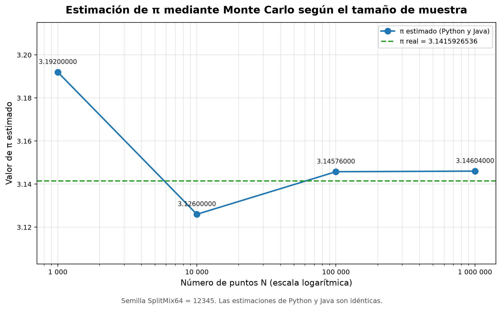
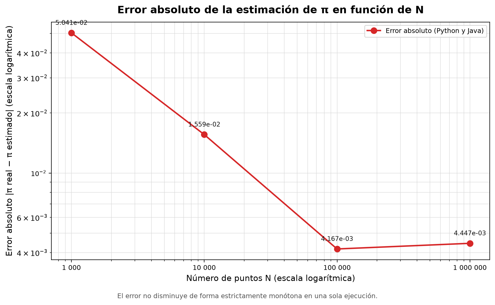
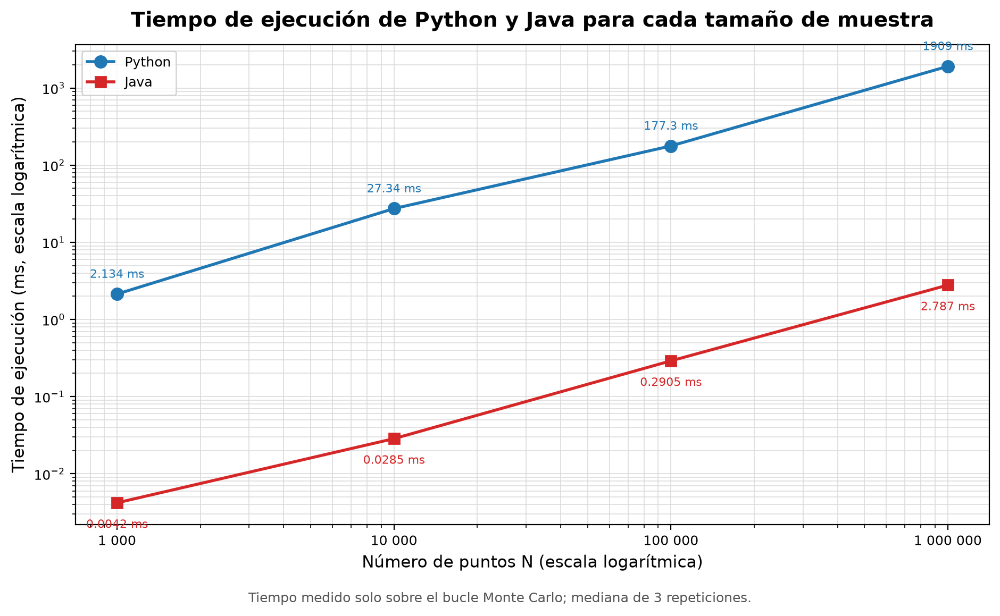

# Informe de práctica — APE N.º 007

## 1. Datos generales

| Campo | Información |
|---|---|
| Asignatura | Simulación |
| Práctica | APE N.º 007 |
| Tema | Estimación de resultados mediante el método de Monte Carlo |
| Estudiante | Ismael González |
| Fecha de ejecución | 12 de noviembre de 2026 |
| Entorno | Windows 11, Python 3.14.6, Java 26.0.1 |

---

## 2. Título de la práctica

**Estimación de π mediante el método de Monte Carlo y comparación de implementaciones en Python y Java.**

---

## 3. Objetivos

1. Implementar un experimento de estimación de π mediante el método Monte Carlo.
2. Analizar la influencia del tamaño de muestra sobre el error absoluto.
3. Comparar los resultados y los tiempos de ejecución obtenidos en Python y Java bajo condiciones experimentales equivalentes.

---

## 4. Materiales y herramientas

| Herramienta | Versión | Uso |
|---|---:|---|
| Python | 3.14.6 | Implementación del experimento y procesamiento de resultados |
| NumPy | 2.5.4 | Procesamiento numérico y apoyo en la comparación |
| pandas | 3.1.1 | Organización de datos y exportación CSV |
| Matplotlib | 3.11.2 | Generación de gráficos PNG |
| Java | 26.0.1 | Implementación independiente del experimento |
| `System.nanoTime()` | Biblioteca estándar | Medición de tiempos en Java |
| `MessageDigest` / `ByteBuffer` | Biblioteca estándar | Verificación SHA-256 de la secuencia |
| Windows 11 | 10.0.26300 | Sistema operativo de ejecución |
| Git | — | Control de versiones del proyecto |

No se utilizaron bases de datos, servicios externos, llamadas de red ni bibliotecas estadísticas de terceros. El generador SplitMix64 y el experimento Monte Carlo se implementaron directamente en Python y Java.

---

## 5. Fundamento teórico

El método Monte Carlo permite estimar cantidades numéricas mediante la generación repetida de muestras aleatorias. En esta práctica se aprovecha la relación entre el área de un cuarto de círculo de radio 1 y el área del cuadrado unitario que lo contiene.

Si se generan puntos `(x, y)` uniformes en `[0, 1) × [0, 1)`, la probabilidad de que un punto caiga dentro del cuarto de círculo es:

```text
P(interior) = (π / 4) / 1 = π / 4
```

Por lo tanto, la proporción observada `Nc / N` estima `π / 4` y el estimador de π es:

```text
π̂ = 4 × Nc / N
```

La condición de pertenencia es:

```text
x² + y² ≤ 1
```

El error absoluto se calcula como:

```text
E = |π real − π̂|
```

Por la ley de los grandes números, `π̂` converge a π cuando `N → ∞`. Si `Nc` se modela como una variable binomial con parámetros `N` y `p = π / 4`, la desviación estándar teórica del estimador es:

```text
σ(π̂) ≈ 4 × sqrt(p × (1 − p) / N)
```

Esto implica que el error típico disminuye aproximadamente como `1 / sqrt(N)`. En una ejecución individual el error no necesariamente disminuye de forma monótona, porque cada muestra es una realización aleatoria.

La calidad del generador pseudoaleatorio es esencial: un generador sesgado o correlacionado puede producir errores sistemáticos que el aumento de `N` no corrige. Por esta razón se utilizó el generador SplitMix64, determinista y reproducible, con la misma semilla en ambos lenguajes.

---

## 6. Procedimiento y metodología

### 6.1 Inicio

Se preparó el entorno de desarrollo y se verificaron las versiones disponibles:

```text
Python 3.14.6
NumPy 2.5.4
pandas 3.1.1
Matplotlib 3.11.2
Java 26.0.1
```

Se revisó el modelo matemático del método Monte Carlo para estimar π, la condición de pertenencia al cuarto de círculo y la fórmula del error absoluto. También se definió el procedimiento para que ambas implementaciones fueran comparables: mismo generador pseudoaleatorio, misma semilla, misma conversión a `double` y mismo orden de operaciones.

### 6.2 Desarrollo

1. Ambas implementaciones se organizaron bajo el patron MVC: modelo (SplitMix64, MonteCarlo, filas de resultados y repositorio CSV), vista (consola, informes y graficos) y controlador (orquestacion de experimentos, cronometraje y comparacion).
2. Se implementó SplitMix64 en Python y Java con las mismas constantes y la misma semilla (`12345`).
2. Se implementó el experimento Monte Carlo para los tamaños `1 000`, `10 000`, `100 000` y `1 000 000` de puntos.
3. Se implementó el cálculo de `Nc`, la estimación de π y el error absoluto.
4. Se incorporó un calentamiento global y un calentamiento por tamaño para reducir el efecto de la compilación JIT y de la caché.
5. Se cronometró únicamente el núcleo del algoritmo: generación de puntos y conteo de puntos interiores.
6. Se realizaron tres repeticiones cronometradas por tamaño y se reportó la mediana, el promedio, el mínimo y la desviación estándar.
7. Se exportaron los resultados a CSV y se generó una verificación SHA-256 de la secuencia.
8. Se generaron los tres gráficos solicitados con Matplotlib.

### 6.3 Cierre

Se compararon los resultados de Python y Java, se verificó que las secuencias y las estimaciones coincidieran, se construyó la tabla comparativa y se interpretaron los gráficos. Finalmente, se redactaron el análisis, las conclusiones y las recomendaciones.

---

## 7. Implementación en Python

La implementación se organizó bajo MVC en `python/model/`, `python/view/` y `python/controller/`, con punto de entrada `python/main.py`.

SplitMix64 mantiene un estado entero de 64 bits. En Python se aplica la máscara `2**64 - 1` después de cada operación para reproducir el desbordamiento de 64 bits:

```python
state = (state + gamma) & mask
z = state
z = ((z ^ (z >> 30)) * mix1) & mask
z = ((z ^ (z >> 27)) * mix2) & mask
z ^= z >> 31
x = (z >> 11) * scale
```

La conversión a `double` usa los 53 bits superiores y la constante `2**-53`, de modo que el valor está en `[0, 1)` y es reproducible bit a bit. El experimento genera dos valores por punto y aplica la condición:

```python
if x * x + y * y <= 1.0:
    inside += 1
```

El tiempo se mide con `time.perf_counter_ns()` alrededor de `estimate_pi`, sin incluir escritura de archivos ni impresión:

```python
start_ns = time.perf_counter_ns()
result = estimate_pi(n, DEFAULT_SEED)
elapsed_ns = time.perf_counter_ns() - start_ns
```

La implementación Python también realiza un calentamiento global de 2 × 1 000 000 de puntos antes de medir, para mantener la simetría metodológica con Java.

NumPy se emplea para el procesamiento y la comparación de resultados; la generación se implementa de forma explícita en ambos lenguajes para conservar la equivalencia bit a bit y evitar diferencias introducidas por generadores vectorizados distintos.

Los resultados se organizaron con pandas y se exportaron a `resultados/resultados_python.csv`. La verificación de la secuencia se exportó a `resultados/verificacion_python.csv`.

---

## 8. Implementación en Java

La implementación se organizó bajo MVC en `java/src/ape007/model/`, `java/src/ape007/view/` y `java/src/ape007/controller/`, con punto de entrada `java/src/ape007/Main.java`.

Java utiliza `long` de 64 bits con desbordamiento natural. Los desplazamientos sin signo se realizan con `>>>`:

```java
state += SplitMix64.GOLDEN_GAMMA;
long z = state;
z = (z ^ (z >>> 30)) * SplitMix64.MIX1;
z = (z ^ (z >>> 27)) * SplitMix64.MIX2;
z ^= z >>> 31;
double x = (z >>> 11) * SplitMix64.TWO_POW_MINUS_53;
```

El experimento aplica la misma condición y el mismo orden de operaciones que Python:

```java
if (x * x + y * y <= 1.0) {
    inside++;
}
```

El tiempo se mide con `System.nanoTime()`:

```java
long start = System.nanoTime();
MonteCarlo.ExperimentResult result = MonteCarlo.estimatePi(n, SEED);
long end = System.nanoTime();
double elapsedMs = (end - start) / 1_000_000.0;
```

Los resultados se exportaron a `resultados/resultados_java.csv` y la verificación a `resultados/verificacion_java.csv`. La JVM recibió un calentamiento global de 2 × 1 000 000 de puntos antes de cronometrar, con el fin de reducir el efecto de la compilación JIT.

---

## 9. Resultados experimentales

Los tiempos corresponden a la mediana de tres repeticiones cronometradas. Solo se midió el núcleo Monte Carlo. Las ejecuciones de Python y Java se realizaron de forma consecutiva para reducir diferencias de condiciones. Aun así, los tiempos pueden variar entre corridas por la carga del sistema, la frecuencia del procesador y el entorno de ejecución; por eso se reporta la mediana y no un único valor aislado. El valor real utilizado fue `π = 3.141592653589793`.

| N | Nc | π estimado | Error absoluto | Tiempo Python (ms) | Tiempo Java (ms) |
|---:|---:|---:|---:|---:|---:|
| 1 000 | 798 | 3.1920000000 | 0.0504073464 | 2.1338 | 0.0042 |
| 10 000 | 7 815 | 3.1260000000 | 0.0155926536 | 27.3360 | 0.0285 |
| 100 000 | 78 644 | 3.1457600000 | 0.0041673464 | 177.2680 | 0.2905 |
| 1 000 000 | 786 510 | 3.1460400000 | 0.0044473464 | 1908.5674 | 2.7869 |

La mejor aproximación de esta ejecución se obtuvo con `N = 100 000`, con error absoluto `0.0041673464`.

Los resultados detallados de cada lenguaje están en:

- `resultados/resultados_python.csv`
- `resultados/resultados_java.csv`
- `resultados/resultados.csv` (tabla combinada)

### Verificación de la reproducibilidad

Se generaron 1 000 pares `(x, y)` con la semilla `12345` y se calculó SHA-256 sobre los 2 000 valores `double`. El hash fue idéntico en Python y Java:

```text
05765a7a2b04f628206012cba5e5185f930b28b161aec840806a81beaf261004
```

Además, los primeros 10 pares coincidieron bit a bit y los valores de `Nc` y π fueron iguales en los cuatro experimentos. El informe completo se encuentra en `resultados/verificacion.txt`.

---

## 10. Tabla comparativa

| N | π estimado | Error absoluto | Tiempo Python | Tiempo Java |
|---:|---:|---:|---:|---:|
| 1 000 | 3.1920000000 | 0.0504073464 | 2.1338 ms | 0.0042 ms |
| 10 000 | 3.1260000000 | 0.0155926536 | 27.3360 ms | 0.0285 ms |
| 100 000 | 3.1457600000 | 0.0041673464 | 177.2680 ms | 0.2905 ms |
| 1 000 000 | 3.1460400000 | 0.0044473464 | 1908.5674 ms | 2.7869 ms |

Debido a que ambas implementaciones utilizan la misma secuencia pseudoaleatoria y el mismo orden de operaciones, las columnas `π estimado` y `Error absoluto` son idénticas en Python y Java. La comparación de tiempos es válida para el equipo y el entorno utilizados; no constituye un benchmark universal.

---

## 11. Gráficos

### 11.1 Estimación de π



El gráfico muestra la aproximación de π para los cuatro tamaños de muestra y la línea horizontal del valor real. La estimación se estabiliza alrededor de `3.146` en los tamaños mayores.

### 11.2 Error absoluto



El error absoluto se representa en escala logarítmica. Se observa una tendencia general a disminuir con `N`, aunque no de forma estrictamente monótona en esta ejecución.

### 11.3 Tiempos de ejecución



Java fue más rápido en los cuatro tamaños. La escala logarítmica permite comparar tiempos que difieren en más de dos órdenes de magnitud.

### 11.4 Puntos generados (dentro y fuera del círculo)

Se genera una gráfica por cada tamaño de muestra:

- `resultados/monte_carlo_puntos_1000.png`
- `resultados/monte_carlo_puntos_10000.png`
- `resultados/monte_carlo_puntos_100000.png`
- `resultados/monte_carlo_puntos_1000000.png`

Cada una muestra una muestra de puntos `(x, y)` generados con SplitMix64 (semilla `12345`). Los puntos azules cumplen `x² + y² ≤ 1` y se cuentan como `Nc`; los rojos quedan fuera. La frontera verde es el cuarto de círculo unitario. Estas gráficas ilustran visualmente el significado de `Nc` en la fórmula `π ≈ 4 × Nc / N`.

---

## 12. Análisis de resultados

### 12.1 ¿Cómo cambia la estimación de π cuando aumenta el número de puntos?

La estimación se aproxima al valor real conforme aumenta `N`. En los datos obtenidos pasó de `3.1920000000` con 1 000 puntos a `3.1260000000` con 10 000, `3.1457600000` con 100 000 y `3.1460400000` con 1 000 000. Los dos primeros tamaños presentan desviaciones mayores; con 100 000 y 1 000 000 la estimación se estabiliza alrededor de `3.146`, con errores del orden de `4 × 10⁻³`. La tendencia es consistente con la convergencia del método Monte Carlo, aunque no es estrictamente monótona.

### 12.2 ¿Qué relación existe entre el tamaño de muestra y el error absoluto?

El error típico disminuye con `N` aproximadamente como `1 / sqrt(N)`. La desviación estándar teórica del estimador, calculada con `p = π / 4`, se muestra a continuación:

| N | σ teórica del estimador |
|---:|---:|
| 1 000 | 0.05193 |
| 10 000 | 0.01642 |
| 100 000 | 0.00519 |
| 1 000 000 | 0.00164 |

Los errores observados (`0.05041`, `0.01559`, `0.00417`, `0.00445`) son coherentes con esa escala. Al multiplicar `N` por 10, el error típico se reduce aproximadamente por `sqrt(10) ≈ 3.16`. Esta es una característica fundamental del método Monte Carlo: para reducir el error a la mitad se necesita aproximadamente cuatro veces más puntos.

### 12.3 ¿En cuál de los tamaños de muestra se obtuvo una mejor aproximación de π?

En esta ejecución, la mejor aproximación se obtuvo con `N = 100 000`, con un error absoluto de `0.0041673464`. El resultado con `N = 1 000 000` fue muy cercano (`0.0044473464`), pero ligeramente peor. Esto no contradice la teoría: una ejecución individual con más puntos puede presentar una fluctuación mayor que otra con menos puntos, aunque en promedio el error disminuya al aumentar `N`.

### 12.4 ¿Qué lenguaje presentó menor tiempo de ejecución?

Java presentó menor tiempo en los cuatro tamaños:

- 1 000 puntos: `0.0042 ms` frente a `2.1338 ms`.
- 10 000 puntos: `0.0285 ms` frente a `27.3360 ms`.
- 100 000 puntos: `0.2905 ms` frente a `177.2680 ms`.
- 1 000 000 puntos: `2.7869 ms` frente a `1908.5674 ms`.

El factor observado estuvo entre aproximadamente `508.0×` y `959.2×`. La diferencia se explica por la implementación: Java ejecuta el bucle con enteros de 64 bits nativos y la JVM aplica compilación Just-In-Time, mientras que Python interpreta el bucle y emula la aritmética de 64 bits con enteros de precisión arbitraria y máscaras. El resultado es específico de este código, este equipo y este entorno.

### 12.5 ¿Por qué los resultados obtenidos en Python y Java pueden ser diferentes?

Dos implementaciones pueden diferir por usar generadores pseudoaleatorios distintos, semillas distintas, conversiones diferentes a `double`, órdenes de operaciones distintos, bibliotecas matemáticas diferentes o plataformas y compiladores diferentes.

En esta práctica se controlaron esos factores: mismo SplitMix64, misma semilla, misma conversión a `double`, mismo orden de operaciones y misma condición. Por ello, los valores de `Nc` y π fueron idénticos en Python y Java. La verificación SHA-256 y la comparación bit a bit de los primeros pares confirman que la secuencia fue la misma. Las diferencias observadas son únicamente de tiempo de ejecución.

### 12.6 ¿Qué importancia tiene la generación de números pseudoaleatorios en el método Monte Carlo?

Es fundamental. El método supone que los puntos son muestras independientes de una distribución uniforme. Si el generador presenta sesgos, correlaciones, un periodo corto o una distribución no uniforme, la estimación puede desviarse de forma sistemática y el aumento de `N` no corrige necesariamente el problema. Un generador reproducible también permite repetir el experimento, auditar los resultados y comparar implementaciones. SplitMix64 permitió obtener una secuencia determinista, verificable y equivalente en ambos lenguajes.

### 12.7 ¿El aumento del número de puntos garantiza que cada ejecución obtenga un resultado más cercano al valor real?

No. El aumento de `N` reduce el error típico y garantiza convergencia en probabilidad, pero no asegura que cada ejecución individual sea más cercana que la anterior. En los datos obtenidos, el error bajó de `0.05041` a `0.01559` y luego a `0.00417`, pero subió ligeramente a `0.00445` al pasar de 100 000 a 1 000 000 de puntos. Es una fluctuación normal del estimador aleatorio. Para evaluar la tendencia con mayor solidez se recomienda repetir el experimento con muchas semillas y analizar la distribución del error.

### 12.8 ¿Qué aplicaciones reales puede tener el método Monte Carlo en ingeniería, economía, informática y ciencias?

- **Ingeniería:** análisis de confiabilidad, riesgo estructural, propagación de incertidumbre, simulación de sistemas térmicos, eléctricos y de manufactura.
- **Economía y finanzas:** valoración de opciones, estimación de riesgo de portafolios, simulación de escenarios macroeconómicos y análisis de decisiones bajo incertidumbre.
- **Informática:** algoritmos probabilísticos, renderizado y trazado de rayos, estimación de integrales, evaluación de redes, aprendizaje automático y simulación de sistemas distribuidos.
- **Ciencias:** física de partículas, simulación molecular, dinámica de fluidos, modelos climáticos, genética de poblaciones, epidemiología y estudios de incertidumbre en experimentos.

---

## 13. Conclusiones

1. **Se implementó el experimento Monte Carlo en Python y Java.** Ambas versiones estiman π con la misma fórmula y, gracias al uso de SplitMix64 con semilla fija y una conversión idéntica a `double`, producen exactamente los mismos valores de `Nc` y π. La equivalencia se verificó con SHA-256 y con la comparación bit a bit de los primeros pares.

2. **El tamaño de muestra influye directamente en el error.** Los errores observados fueron `0.05041`, `0.01559`, `0.00417` y `0.00445` para 1 000, 10 000, 100 000 y 1 000 000 de puntos. La tendencia es consistente con una reducción proporcional a `1 / sqrt(N)`, aunque una sola ejecución no garantiza una mejora monótona. La mejor aproximación de esta ejecución se obtuvo con 100 000 puntos.

3. **Java obtuvo menores tiempos de ejecución en este entorno.** Para 1 000 000 de puntos, la mediana fue `2.7869 ms` en Java frente a `1908.5674 ms` en Python, un factor cercano a `684.8×`. La diferencia se atribuye a la implementación y a la compilación JIT de la JVM, no a una superioridad universal del lenguaje. La reproducibilidad y la igualdad numérica quedaron comprobadas.

---

## 14. Recomendaciones

- **Reproducibilidad:** fijar la semilla, documentar el generador, la conversión a `double` y las versiones de las herramientas. Guardar un hash o una muestra verificable de la secuencia.
- **Selección del tamaño de muestra:** elegir `N` a partir del error objetivo. Como el error típico escala con `1 / sqrt(N)`, reducir el error a la mitad requiere aproximadamente cuatro veces más puntos.
- **Medición de tiempos:** cronometrar solo el núcleo del algoritmo, realizar calentamiento y varias repeticiones, y reportar la mediana junto con la dispersión. Comparar únicamente ejecuciones realizadas en el mismo equipo y bajo condiciones equivalentes.
- **Comparación entre lenguajes:** usar el mismo algoritmo, la misma secuencia de entrada y el mismo orden de operaciones; verificar la equivalencia numérica antes de comparar tiempos. Tener en cuenta el calentamiento de la JVM y evitar incluir entrada/salida en la medición.

### Limitaciones

- Los tiempos dependen del hardware, del sistema operativo, de la carga del equipo y de la versión de la JVM o del intérprete.
- Cada tamaño de muestra se ejecutó con una sola semilla. Para caracterizar la distribución del error sería conveniente repetir el experimento con muchas semillas.
- El experimento es de un solo hilo y no explora paralelización, vectorización ni optimizaciones específicas de hardware.
- La verificación cubre 1 000 pares y los cuatro valores de `Nc`; es una comprobación fuerte para este experimento, pero no una prueba formal de la calidad estadística de todo el periodo del generador.

---

## 15. Bibliografía

- Material de clase de la asignatura **Simulación**, semana 6: *Estimación de resultados mediante el método de Monte Carlo*. Diapositivas proporcionadas por la asignatura.
- Guía de práctica **APE N.º 007: Estimación de resultados mediante el método de Monte Carlo**. Material de la asignatura.
